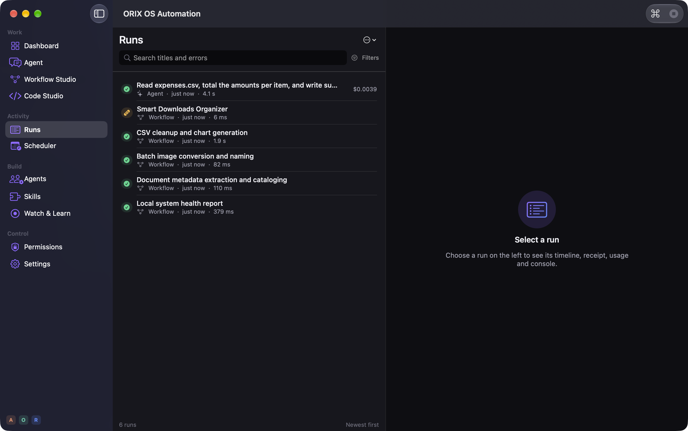
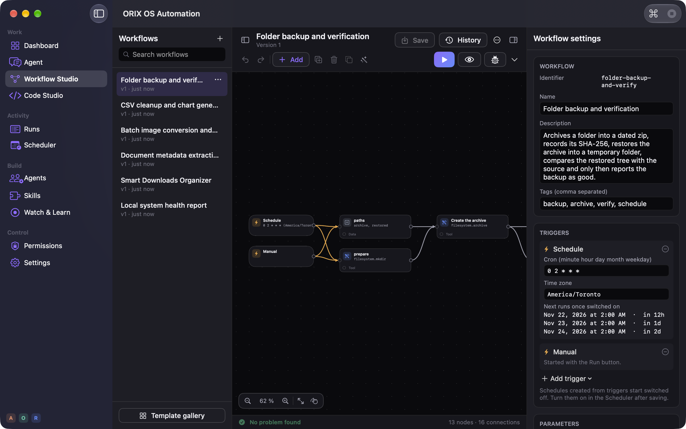
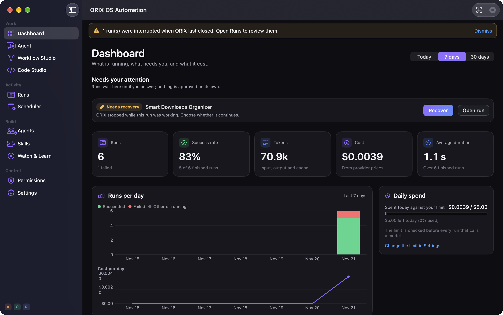
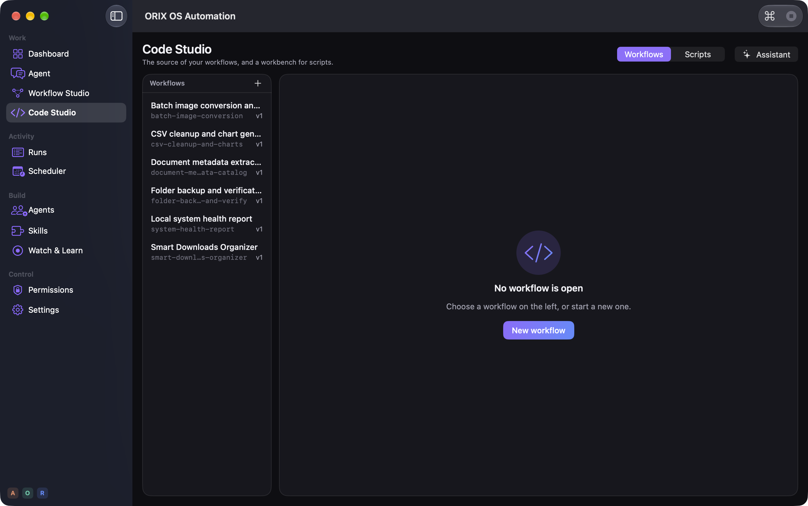
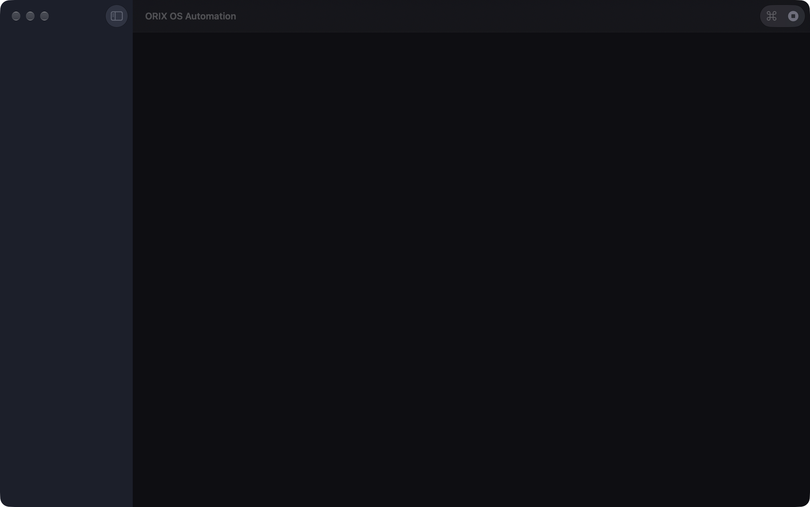
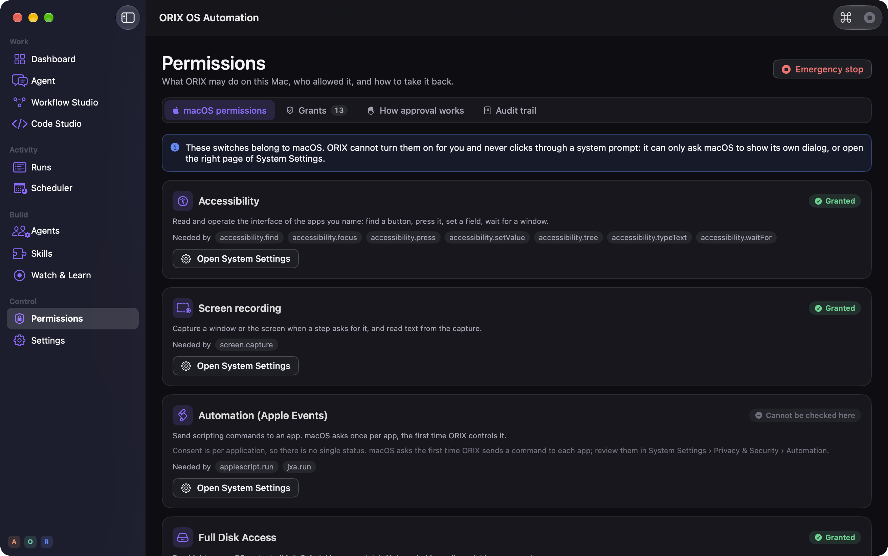
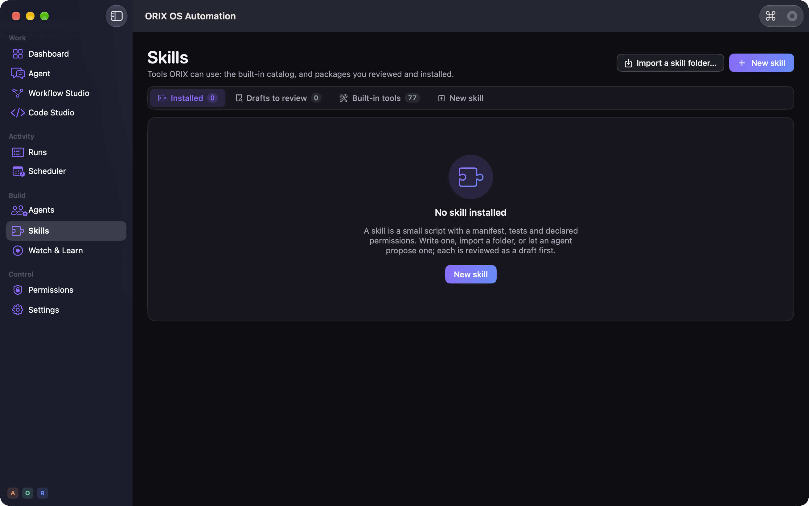
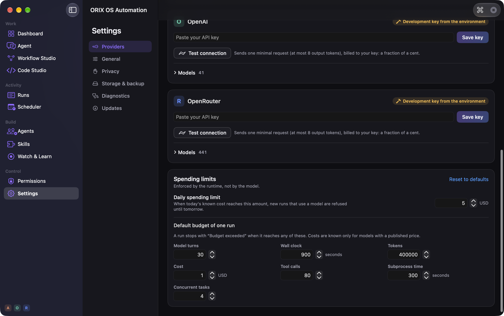

<!--
ORIX OS Automation
File: README.md
Author: Simon-Pierre Boucher
Contact: contact@spboucher.ai
-->
# ORIX OS Automation

A native macOS app that carries out work on your Mac from a stated objective. It plans, asks before anything that
matters, acts through real tools, and checks the result itself. No account, no server: you bring your own model
key, and everything else stays on the Mac.



The screenshots in this file are the running app showing real runs made on the development Mac
(`Scripts/screenshots.sh`), not mock-ups.

## What it does

- **Agent** — describe a task; choose the folder it may work in and how much it may do there. Guided mode shows a
  plan first. Every tool call is checked against what you granted; the rest asks.
- **Workflow Studio** — the same automation as a graph: steps, conditions, loops, approvals, verification.
  Dry run, step debugger, version history.
- **Code Studio** — the same workflow as YAML or JSON with validation, completion and diffs; a script workbench
  that runs Bash, Python, AppleScript, JXA, Swift and JavaScript through the same policy and sandbox.
- **Runs** — every run with its timeline, cost, artifacts and a receipt of the checks the runtime performed.
- **Scheduler** — cron with time zones, folder changes, login and system triggers; optional background agent.
- **Skills** — small confined programs that become tools, reviewed and tested before installation.
- **Permissions** — macOS permission status, every grant, revoke one or all, emergency stop.



| | |
|---|---|
|  |  |
|  |  |
|  |  |

## How control works

1. Everything an agent or workflow does goes through one executor. Arguments are validated, the tool itself states
   which files, hosts, apps or programs the call touches, and a deny-by-default policy engine decides.
2. A grant is specific (this folder, this host, this app), has a maximum tier, and lasts for one call, one run,
   one workflow, or until you revoke it. Credential stores and system locations can never be granted.
3. Irreversible actions are approved one call at a time. Scheduled runs are never auto-approved.
4. Content read from files, pages and apps is handed to the model as data. Nothing a model writes can grant a permission.
5. A run is `SUCCEEDED` only when the runtime's own checks say so. The model's closing statement is shown as a claim.
6. Scripts and skills run in a sandbox limited to the granted folders, with networking off unless a host was granted.

Details: [`docs/security/threat-model.md`](docs/security/threat-model.md).

## Requirements and install

macOS 15 or later (built and tested on macOS 27, Apple Silicon). Open the notarized disk image, drag the app to
Applications, and follow the welcome guide. You need an API key from Anthropic, OpenAI or OpenRouter; it is stored
in your login Keychain. See [`docs/user-guide/guide.md`](docs/user-guide/guide.md).

## Command line

`orixctl` drives the same services without the window:

```bash
cd Packages/ORIXServices && swift build
.build/debug/orixctl tools                                  # the registered tools
.build/debug/orixctl workflow templates                     # the 15 built-in examples
.build/debug/orixctl workflow install system-health-report
.build/debug/orixctl --approve all workflow run system-health-report --accept-permissions
.build/debug/orixctl run <run-id>                           # the execution receipt
```

## Building

```bash
Scripts/build/build.sh debug        # XcodeGen + Debug build
Scripts/test/test-all.sh            # every package (live provider suites print SKIPPED without keys)
Scripts/release/release.sh          # tests, Release build, secret scan, sign check, notarize, DMG, evidence
```

No third-party code: Swift 6, SwiftUI and AppKit, system frameworks only. The repository layout:

| Path | Content |
|---|---|
| `App/` | The app target: entry point, main window, menu-bar item, background-agent mode |
| `Packages/ORIXCore` | Contracts shared by everything |
| `Packages/ORIXSecurity`, `ORIXPersistence` | Policy engine, Keychain, audit log; SQLite store |
| `Packages/ORIXProviderAdapters` | Anthropic, OpenAI, OpenRouter |
| `Packages/ORIXToolRegistry`, `ORIXAppleAutomation`, `ORIXBrowserAutomation`, `ORIXSkills` | The executor and the tools |
| `Packages/ORIXAgentRuntime`, `ORIXWorkflowEngine`, `ORIXScheduler` | Agent loop, workflows, scheduling |
| `Packages/ORIXServices` | Composition root and `orixctl` |
| `Packages/ORIXAppUI`, `ORIXFeature*` | Design system, app model, the sections of the app |
| `Workflows/` | Built-in examples, their sample data, the JSON Schema |
| `docs/` | Architecture, security, API, workflow language, user guide, release |

## Documentation

- [Implementation status: what is verified, what is not built](docs/implementation-status.md)
- [Architecture](docs/architecture/overview.md) · [Environment audit](docs/architecture/environment-audit.md) · [Plan and risks](docs/architecture/implementation-plan.md)
- [Threat model](docs/security/threat-model.md)
- [User guide](docs/user-guide/guide.md)
- [Workflow language](docs/workflows/language-reference.md) · [Examples](docs/workflows/examples.md)
- [Tool API](docs/api/tool-api.md) · [Tool reference (generated)](docs/api/tools.md)
- [Writing a skill](docs/skills/skill-development.md)
- [Release runbook](docs/release/runbook.md) · [Changelog](CHANGELOG.md)

## Limits worth knowing before you rely on it

- Verified on one Mac and one macOS version. The Intel slice and macOS 15–26 were never run.
- The background agent and notifications were not exercised end to end.
- No automatic updater.
- The full list is in [`docs/implementation-status.md`](docs/implementation-status.md).

© 2026 Simon-Pierre Boucher. All rights reserved. See `LICENSE`.
